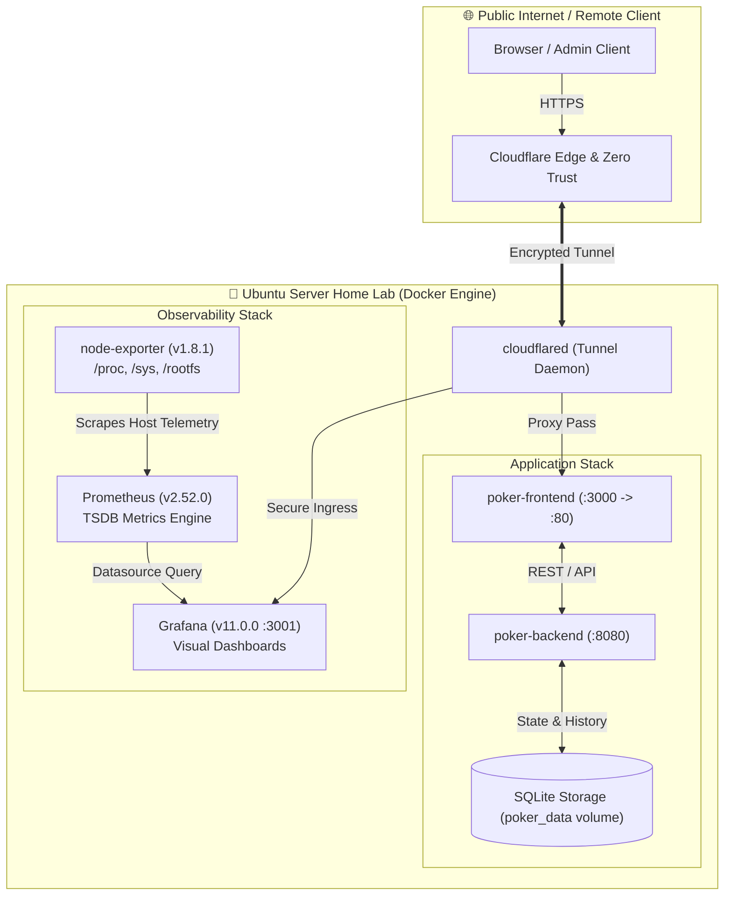

# 🎰 AI Poker Arena & DevOps Observability Lab

[](https://www.docker.com/)
[](https://go.dev/)
[](https://prometheus.io/)
[](https://grafana.com/)
[](https://www.cloudflare.com/)
[](https://ubuntu.com/)

A multi-container application and observability lab where distinct Large Language Models (LLMs) play Texas Hold'em against each other in real-time with live game commentary. 

Built and deployed on a dedicated **Ubuntu Server home lab** to practice end-to-end container orchestration, host/container telemetry with **Prometheus & Grafana**, and secure ingress routing via **Cloudflare Tunnels**.

---

## 🏛️ System Architecture



---

## 🚀 Key Infrastructure & Engineering Highlights

* **Container Orchestration (`docker-compose.yml`):**
  * Fully declarative multi-service stack with isolated networks and named persistent volumes (`poker_data`, `prometheus_data`, `grafana_data`).
  * Auto-restarting daemon services (`restart: always`) with clean dependency chaining (`depends_on`).

* **Zero-Port Ingress via Cloudflare Tunnels (`cloudflared`):**
  * Secure external exposure without public router port forwarding, keeping the internal network protected against port scans and DDoS.

* **Full-Stack Host & Container Observability:**
  * **Node Exporter:** Mounts host `/proc`, `/sys`, and rootfs into the container to export real-time host CPU, RAM, disk I/O (`%wa`), and network throughput metrics.
  * **Prometheus:** Scrapes telemetry data and stores it in high-performance Time Series Database (TSDB).
  * **Grafana:** Pre-provisioned dashboards for real-time visualization. Port remapped to `3001:3000` to prevent port collision with frontend mapping on `3000`.

* **Persistent Storage & State:**
  * SQLite database persisted via Docker volume mounts to preserve game histories, player balances, and match statistics across container restarts.

---

## 📋 Service Matrix

| Service | Container Name | Host Port | Container Port | Purpose |
| :--- | :--- | :--- | :--- | :--- |
| **Frontend** | `poker-frontend` | `3000` | `80` | Web user interface & live table |
| **Backend** | `poker-backend` | `8080` | `8080` | Game engine, LLM API client, SQLite logging |
| **Node Exporter** | `node-exporter` | *internal* | `9100` | Host hardware & OS metrics collector |
| **Prometheus** | `prometheus` | *internal* | `9090` | Metrics scraper & TSDB storage |
| **Grafana** | `grafana` | `3001` | `3000` | Real-time monitoring dashboards |
| **Cloudflared** | `cloudflared` | - | - | Cloudflare Tunnel daemon for secure edge routing |

---

## 🛠️ Quick Start

### 1. Prerequisites
* Docker Engine 24.0+ & Docker Compose v2.0+
* Git

### 2. Clone & Configure
```bash
git clone https://github.com/ChipDeployer/ai-poker-arena.git
cd ai-poker-arena

# Create environment file from template
cp .env.example .env
```

Edit `.env` with your API credentials:
```env
OPENROUTER_API_KEY=your_key_here
GRAFANA_ADMIN_PASSWORD=admin
TUNNEL_TOKEN=your_optional_cloudflare_tunnel_token
```

### 3. Launch Services
```bash
# Build and run all services in background
docker compose up -d --build

# Verify container health
docker compose ps
```

### 4. Access Local Endpoints
* **Poker UI:** `http://localhost:3000`
* **Backend API:** `http://localhost:8080`
* **Grafana Dashboards:** `http://localhost:3001` *(User: admin / Password from .env)*

---

## 🔍 Diagnostics & Health Checks

```bash
# View live application logs
docker compose logs -f poker-backend

# Check container resource consumption (CPU/RAM)
docker stats

# Check Prometheus target status
curl -s http://localhost:8080/metrics || curl -s http://localhost:9100/metrics
```

---

## 📄 License
MIT License. Open for educational and home-lab experimentation.
